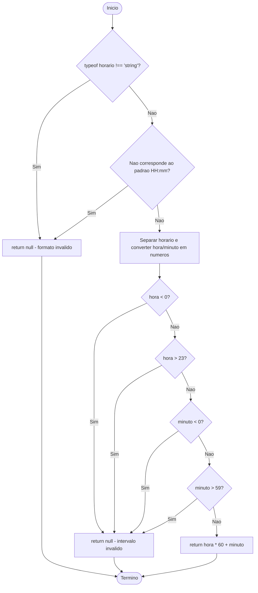
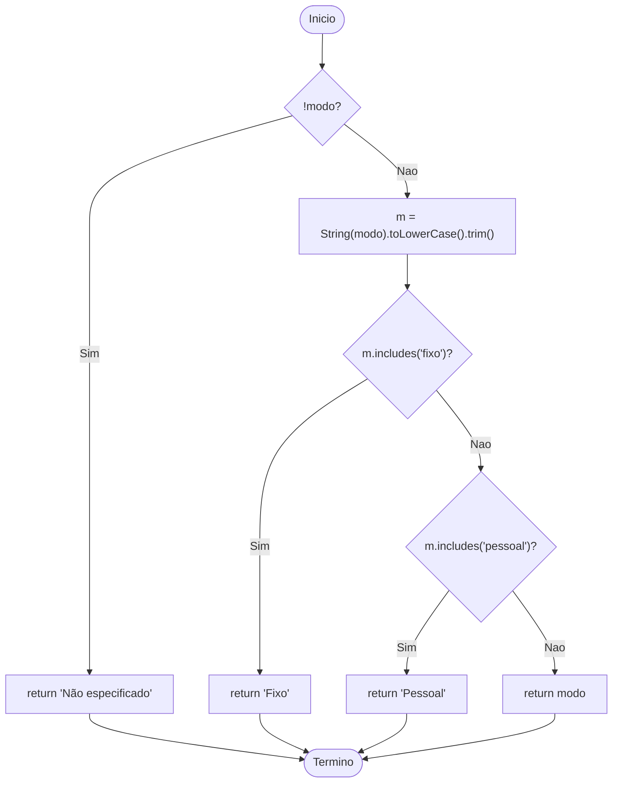

# Relatorio de Analise do Fluxo de Controle

## 1. Objetivo

Documentar o codigo-fonte e o Grafo de Fluxo de Controle (GFC) de duas
funcoes do PWA, identificando seus nos, arestas e nos predicados:

- [converterHorarioParaMinutos](./static/pesquisadora/metricas.js#L9);
- [normalizarModo](./static/pesquisadora/metricas.js#L52).

As duas funcoes pertencem ao modulo
[metricas.js](./static/pesquisadora/metricas.js).

## 2. Criterios de representacao e contagem

- Cada bloco de processamento, decisao, retorno, inicio e termino constitui
  um no.
- Cada seta direcionada entre dois nos constitui uma aresta.
- Um no predicado representa uma decisao com duas saidas: Sim e Nao.
- Nas expressoes compostas com `||`, cada condicao e representada
  separadamente, explicitando a avaliacao em curto-circuito do JavaScript.
- Cada ocorrencia de `return` possui seu proprio no e converge para um
  unico no de termino da funcao.
- Os grafos representam o fluxo normal de execucao, sem arestas para
  excecoes. Chamadas a metodos e callbacks de biblioteca nao sao expandidas.

Notacao utilizada:

| Simbolo | Significado |
|---|---|
| N | Quantidade total de nos |
| E | Quantidade total de arestas |
| P_red | Quantidade de nos predicados |

## 3. Funcao converterHorarioParaMinutos

### 3.1. Finalidade

Converter um horario no formato `HH:mm` para o total de minutos desde a
meia-noite. A funcao retorna `null` quando o argumento nao e uma string no
formato esperado ou quando as horas e os minutos estao fora dos intervalos
de 0 a 23 e de 0 a 59, respectivamente.

### 3.2. Codigo-fonte

```javascript
function converterHorarioParaMinutos(horario) {
  if (typeof horario !== "string" || !/^\d{2}:\d{2}$/.test(horario)) return null;
  const [hora, minuto] = horario.split(":").map(Number);
  if (hora < 0 || hora > 23 || minuto < 0 || minuto > 59) return null;
  return (hora * 60) + minuto;
}
```

### 3.3. Grafo de Fluxo de Controle



### 3.4. Contagem

| Elemento | Total | Identificacao |
|---|---:|---|
| Nos (N) | 12 | A, B, C, D, E, F, G, H, I, J, K e L |
| Arestas (E) | 17 | Setas direcionadas do grafo |
| Nos predicados (P_red) | 6 | B, C, F, G, H e I |

Arestas: A-B, B-D, B-C, C-D, C-E, E-F, F-J, F-G, G-J,
G-H, H-J, H-I, I-J, I-K, D-L, J-L e K-L.

As verificacoes `hora < 0` e `minuto < 0` permanecem no grafo porque existem
no codigo-fonte. Entretanto, suas ramificacoes verdadeiras sao inviaveis
apos a validacao pelo padrao `HH:mm`, que admite apenas digitos. Portanto,
o grafo estrutural inclui caminhos que nao podem ser percorridos por
entradas da funcao.

## 4. Funcao normalizarModo

### 4.1. Finalidade

Normalizar a identificacao do modo de uso. Valores falsos na conversao
booleana do JavaScript resultam em `"Não especificado"`. Valores cuja
representacao normalizada contem `"fixo"` ou `"pessoal"` resultam em
`"Fixo"` e `"Pessoal"`, respectivamente. Nos demais casos, o argumento
original e retornado.

A verificacao de `"fixo"` precede a de `"pessoal"`; assim, quando ambos
estao presentes no texto, o resultado e `"Fixo"`.

### 4.2. Codigo-fonte

```javascript
function normalizarModo(modo) {
  if (!modo) return "Não especificado";
  const m = String(modo).toLowerCase().trim();
  if (m.includes("fixo")) return "Fixo";
  if (m.includes("pessoal")) return "Pessoal";
  return modo;
}
```

### 4.3. Grafo de Fluxo de Controle



### 4.4. Contagem

| Elemento | Total | Identificacao |
|---|---:|---|
| Nos (N) | 10 | A, B, C, D, E, F, G, H, I e J |
| Arestas (E) | 12 | Setas direcionadas do grafo |
| Nos predicados (P_red) | 3 | B, E e G |

Arestas: A-B, B-C, B-D, D-E, E-F, E-G, G-H, G-I, C-J,
F-J, H-J e I-J.

## 5. Resumo dos resultados

| Funcao | N | E | P_red |
|---|---:|---:|---:|
| converterHorarioParaMinutos | 12 | 17 | 6 |
| normalizarModo | 10 | 12 | 3 |

## 6. Conclusao

A funcao `converterHorarioParaMinutos` apresenta mais decisoes devido a
validacao de tipo, formato e intervalos. A funcao `normalizarModo` possui
um fluxo de decisoes sequenciais com retornos antecipados.

As contagens correspondem aos grafos apresentados e dependem da
granularidade adotada. Uma representacao que agrupasse cada expressao
composta de um `if` em uma unica decisao produziria contagens diferentes.
Esta analise nao modifica o codigo nem as regras de negocio do projeto.
